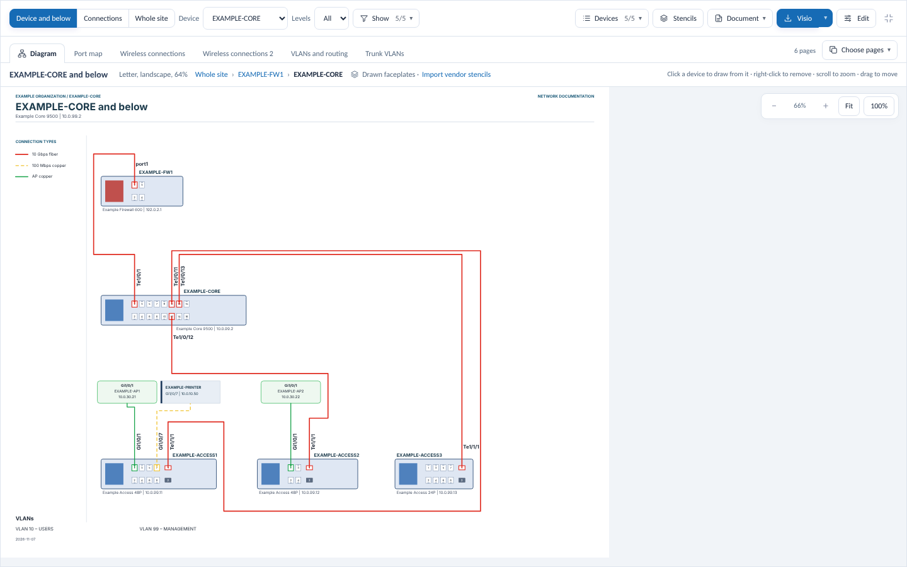
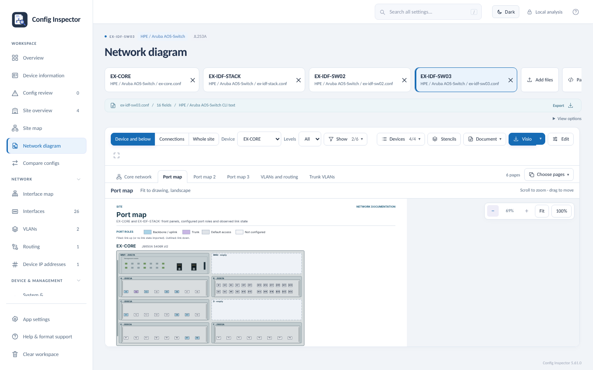

# Network diagram (turned off)

The **Network diagram** tool is turned off in Config Inspector 5.69.0 and later, because it is not yet working as
intended (owner decision, 2026-11-08). Its complete code stays in this repository, unchanged, together with its tests,
so it can be finished and turned back on:

- **Last release with it on:** [Config Inspector 5.68.0](https://github.com/TechSavage1989/Configuration-Inspector/releases/tag/v5.68.0)
  (tag `v5.68.0`).
- **Code:** `webview/diagram.js` (drawing, routing, documentation pages, Visio, SVG and printable output),
  `webview/stencils.js` (vendor stencils and hardware packs), `webview/nds_faceplates.js` (NetworkDiagramStudio
  faceplates) and the diagram user interface in `webview/index.html` (`diagramPage` and the functions around it).
- **Switch:** `DIAGRAM_ON` in `webview/index.html`. It is off in releases; adding `?labs=diagram` to the page address,
  or setting `localStorage['config-inspector-labs']` to `diagram`, turns the tool on for development. The browser
  tests that cover it (`tests/diagram-*-browser.cjs`, `supplementary-browser.cjs`, `ui-pickers-browser.cjs`) load the
  page that way, and `tests/diagram-tests.cjs` and `tests/diagram-variety-tests.cjs` test the drawing library directly.
- **To turn it back on:** make `DIAGRAM_ON` true, move the text below back into README.md (Features, Screenshots, How
  to use and Troubleshooting), and release.

## What it does

**Generate network diagrams:** draw any part of the network from the imported neighbor data and open configurations — the selected configuration's device and everything below it, a device and its connections, or the whole site — with switches and firewalls drawn as their real front panels (port positions, connector types and numbers from verified hardware layouts for about 400 firewall and switch models, each from the manufacturer's documentation; other hardware gets a plain faceplate built from its ports), each device's name above its faceplate and its model and address below it, access points and phones beside the ports they use, color-coded links that never overlap, VLANs and a legend. Documentation pages follow the diagram: a port map, wireless connections, VLANs and routing, and trunk VLANs. Click a device to draw from it down, choose which devices to include, and download every page as one editable Visio (.vsdx) file or printable pages.

## Screenshots

<b>A core chassis and everything below it, drawn with the front panels shared with NetworkDiagramStudio</b> 

<b>Documentation pages after the diagram: a port map sheet per device, its front panel marked by VLAN</b> 

## How to use

- **Network diagram** (sidebar, once a configuration or a file with links is open): opens on the device of the selected configuration and everything below it, with the device above it for context. One toolbar holds everything:
  - **Device and below**, **Connections** or **Whole site**, the device and the number of levels. "Below" a device is every device cabled to it from the next level down, so a core switch cabled to both firewalls of an HA pair appears under either firewall.
  - **With configurations alone**, links come from what the configurations say about each other: a port described with another device's name, and a default gateway that is another device's address. A link aggregation is drawn as one link per member port: when the far end names no device ("uplink_to_core"), its uplink ports are used if there are as many of them, and the members are paired in port order (the link's details say so, since configurations cannot show which cable joins which port). Imported neighbor data adds and corrects links. When an export reports a neighbour without its port, the link goes to the far device's interface whose alias the near port's description names (a switch port described "Inside-FW" goes to the firewall's port2, alias "Inside"); otherwise it ends on the device's edge, labelled "port ?", never on a port another link uses. When an export reports a link on a port that is down while the far end's description names another port of this device (such as a firewall's "ha" port for a link on "x3"), the diagram and the Neighbors tables use the described port and show the reported one beside it.
  - **Show**: by default the diagram shows the selected configuration's device, the devices below it that also have an imported configuration, and WAN circuits; tick the upstream device, access points, other devices or **Switches without a configuration** to add them. The choices: the upstream device, WAN circuits (from the firewall's WAN interfaces), access points (optionally **grouped into one box per switch**, with their ports outlined on the switch) and other devices, and whether devices are drawn with stencils, drawn faceplates or boxes.
  - **Devices**: the devices **On this diagram**, each with a **×** to remove it (the device the diagram is drawn from is marked **Drawn from**), and **Clear all** to remove every other device; then the site's devices **Not on this diagram**, each with **Add**. A search box (name, model or address) and a filter (on or off the diagram, or by type) narrow both lists, and **Add shown** / **Remove shown** act on everything the search shows. Right-click a device on the diagram to remove it too; **Undo added and removed devices** brings the original set back. A stack or chassis counts as one device.
  - **Stencils**, **Document** (site name, title, subtitle, file name, **Prepared by** and **Organization**, used on the drawing and in download names), **Visio** and more downloads, and **Full screen** (Esc to leave), which gives the diagram the whole window.
  - Click any device to draw the diagram from it down, and use the path under the toolbar to go back up. Scroll to zoom, drag to move, or use the zoom buttons and **Fit**.
  - **Edit** makes the drawing yours to correct (press **Done** to go back):
    - Drag devices and access points to move them. Hold **Shift** while dragging to keep the move horizontal or vertical: the way the drag started from its starting point. **Shift-click** or **Ctrl-click** adds items to the selection (click a selected one again to take it out), or drag a box on empty space; dragging any selected item moves them all. The middle mouse button moves the view while editing.
    - **Size**: **−** and **+** make the selected devices 10% smaller or larger (with nothing selected, every device); the percentage between them returns to 100%. Ports, modules, stacks and chassis scale with the drawing and the links follow; a device shrinks only as far as its linked ports stay apart.
    - **Place beside**: select one or more items, choose **Left of**, **Right of**, **Above** or **Below**, then click the device to place them beside (Esc cancels). They are centred on it with room for their links, step past anything already there, and when the page edge is in the way everything else moves over instead. Right-click a device for the same choices.
    - **Move to page…** puts the selected devices on a page of their own (or another page you made), listed after the main diagram in the page tabs and in every download; each page can be edited. A link between two pages ends at an off-page reference on both: the device and port at the other end and **See page N**. Move them back to page 1 to bring them back.
    - Links are easy to pick: the link a click would take lights up as the pointer comes within a few pixels of it.
    - Drag a stretch or a corner of a link to move it. A stretch dragged onto the line of another stretch of the same link snaps to it and the two merge. **Ctrl+click** a link to add a point, or a corner to remove it.
    - Double-click a label to change it in a dialog, on as many lines as needed (empty hides it); its box grows to fit the text.
    - Double-click a link to choose the port each end uses.
    - Align the selected items on their left edges, centers or tops, or space them evenly. **Straighten access point links** moves access points over their ports. **Tidy links** routes every link again the cleanest way the app can find (it tries several orders and keeps the one with the fewest crossings, then the fewest bends and the shortest links, in neat parallel tracks); links you drew by hand are redrawn, and **Undo** puts them back.
    - **Undo** and **Reset layout** are there too.
    - **Add link**, **Add device** and **Links** fix what the files don't show: draw a cable, add a device without a configuration (a provider router, an unmanaged switch), and see where each link comes from (imported data, the configurations, or by hand) to remove the wrong ones.
    - Drag the end of a link to move its point on a port; the ring on the stencil moves with it. Right-click a link to add or remove a bend or reset its route.
    - Click a link to select it, as in NetworkDiagramStudio: its bends show as squares, its port ends as fixed dots and each longer middle stretch has a **+** that adds bends. Drag a square to move a bend (it snaps to other links and device edges with a dashed guide; hold **Alt** to turn snapping off, **Shift** to keep it horizontal or vertical), or click it and press **Delete** to remove it or the arrow keys to nudge it. The **Link** row of the edit bar offers **Remove point**, **Edit bend points** (every point as numbers) and **Reset route**; port ends always stay attached.
    - Double-click a device drawn with a stencil (or use **Port points** under **Stencils**) to place its port points: the stencil with a point per port, selected by click, Shift-click or a box, moved by dragging or with the arrow keys, and lined up with **Same height**, **Same column**, **Space across** and **Space down**; a port can also be chosen from a list and placed by its position across and down (%), and **Undo**/**Redo** (Ctrl+Z / Ctrl+Shift+Z) step through the changes. Port points apply to every device drawn with that shape. The editor opens on the whole device; scroll to zoom, drag with the middle button or hold Space to pan, **Fit** to see it all again. Most stencils need no hand work: a device's port groups are matched to the stencil's connection points in order, group by group, ignoring rack-ear points and allowing for a missing point.
    - **Save hardware pack** (under **Stencils**) saves the shapes the site's devices use, with their port points and shape choices, to one file; **Import hardware pack** brings them to another computer without the original stencil files. Packs use NetworkDiagramStudio's hardware pack format (`NDS-hardware`), so the same file opens in both apps: NetworkDiagramStudio reads each shape's picture, its ports by name and the models it fits, and Config Inspector also keeps its Visio masters in the file. Hardware packs saved by NetworkDiagramStudio import here too; their port positions are matched to ports by name.
    - **Ctrl+Z** and **Ctrl+Shift+Z** (or **Undo** and **Redo**) step back and forward through every change.
    - **Wireless connections** pages are edited the same way, each with its own edits.
    - Edits are kept on this computer for each view of the site and go into every download. The zoom and scrolled position stay where they are after each change. Devices that start rows line up on one left edge by default.
  - **Pages:** tabs under the toolbar show the documentation pages that follow the diagram, built from the open configurations and supplementary data. Each is a letter page:
    - **Port map**: one sheet per device, laid out like a switchport diagram builder. A dark header names the device, its model, operating system, firmware and number of interfaces, and the **VLAN key** runs down the right.
      - The device is drawn with the app's own faceplate, the same drawing as on the diagram (NetworkDiagramStudio's front panels, a chassis whole with its module cards, or an imported stencil); each stack member sits under a slim bar ("Member 1 | JL558A | 48 RJ-45 + 4 SFP+") exactly as wide as its faceplate, and a chassis card shows its slot letter (the caption under the chassis names each slot's module).
      - Each port is marked on its jack: filled in its native VLAN's colour, with a dot per tagged VLAN, a diamond for the voice VLAN, an outline in its trunk's colour and black for a stack (VSF) port; its number sits above a top-row port and below a bottom-row one. Routed ports have their own colour, and administratively disabled ports are dashed.
      - Below the ports: **Trunks / LAGs** with their ports, then **Port descriptions** grouped by description, and a legend with "Sheet n / N". When they do not fit under the ports they go in the column under the VLAN key, so a stack keeps its switches as large as the sheet allows and stays on one sheet. A VLAN has the same colour on every sheet.
    - **Port inventory**: separate pages after the port maps, a table of every port of each device (port, description, mode, native VLAN with its colour, tagged VLANs, trunk, voice VLAN, admin state and link state), headed with the ports each page lists ("Ports 1-120 of 260 in 47 rows"). Ports in a row with the same settings share one line ("1/1-49 (49)", "42 up, 7 down"), so a 260-port stack with a few dozen distinct port settings fits on two pages.
    - A device's pages of one kind (its port inventory, a long port map, VLANs and routing) are one tab that scrolls through them all ("Port inventory: CORE (2 pages)"); downloads keep every page.
    - **Wireless connections**: each switch drawn with its access points wired to their own ports: a row above the switch for top-row ports and a row below for bottom-row ports, each access point's name, port and speed, and address stacked over or under its icon, then every access point with its switch port, model, address, speed and link state; links below 1 Gbps are listed.
    - **VLANs and routing**: VLANs with their addresses and devices, other routed interfaces (loopbacks, tunnels, management) and routes, and any address used on two devices. Each address appears once: VLAN interface addresses only in the VLANs table, routed ports with their addresses only in the port inventory.
    - **Trunk VLANs**: native (N) and tagged (T) VLANs for each group of trunk, access point and uplink ports, with as many port columns per table as stay readable and only the VLANs each table's columns carry; further tables follow on the same page under their own heading when they fit.
    - **Choose pages** (next to the tabs) turns each kind of page on or off and chooses which devices appear on the port map.
  - Devices are drawn with the same front panels as **NetworkDiagramStudio**, shared between the two apps (a 5400R zl2 or 5400zl chassis is NetworkDiagramStudio's own chassis panel, with its modules and jacks at the same size): its library of researched faceplates (hundreds of switch, firewall and module models) draws each switch, stack member, chassis module and firewall at its real proportions, with RJ45 jacks, SFP and QSFP cages, LED panels and vendor marks, as plain shapes that stay editable in Visio. Links land on the real jacks; a port in use is ringed in its link color or shows its module in the cage, and port maps put a numbered role square over each jack. A model the shared library does not cover port for port is drawn as before.
  - Faceplates use the verified front-panel layouts that **Interfaces at a glance** uses (Cisco Catalyst, Aruba CX and AOS-S, HPE, FortiGate, Juniper EX, SonicWall, Palo Alto and Sophos models), including a model you choose there: ports sit in their real groups and positions, with their real numbers (for example 49-52 at the left of an Aruba CX 6100), RJ45 jacks drawn taller than wide and SFP and QSFP cages as wider, darker cages. When a configuration names no model, the model is worked out from its ports where only one fits (a Catalyst 9500-24Y4C or 48Y4C, a MikroTik CRS326-24S+2Q+RM) or the family layout is used where several share them (Catalyst 3560E 48-port with its X2 / TwinGig slots, CX 6000 / 6100 12G, 24G and 48G); MikroTik binary backups are read the same way. A modular chassis is drawn as it is built: on an HPE 5406R or 5412R zl2 the management modules sit on top (MM1, with its OOBM port, and MM2), then the module slots two across (A | B, C | D, ...), edge to edge inside the chassis frame, each module card titled with its slot and model ("A · J9993A") and its ports centred, empty slots as dashed blanks. A link from the module nearest the edge facing the device it joins drops straight out; a link from a module further in takes one short step beside its port into its own lane at the module's right side, the steps of neighbouring ports staircased so no link crosses another inside the chassis (the ports sit a little left in their module when it needs the room). Other chassis that list their modules show them in slot order. Other devices use a built-in catalog or their own interfaces, odd ports on top, in blocks of 12. Linked ports are outlined in the link color and named in a band above or below the device.
  - Links are named and colored by cable or fiber type and speed, as in a typical site drawing: "10 Gbps SR fiber" (red), "10 Gbps LR fiber" (blue), "10 Gbps SFP+ DAC" (black), "1 Gbps copper" and "Local handoff" (yellow), "AP copper" (green); dashed when slower than 1 Gbps. The media comes from the port's reported media (`show interfaces status`) or else its connector (SFP cage or RJ45). The connection types are listed in a column at the left; an entry shows it is editable when you point at it. Double-click it (or right-click a link while editing) to change that type's color (from 48 base colors or any other), name, speed, cable type (copper grades, fiber by reach and grade, DACs such as SFP+, SFP28, QSFP28 and breakout DACs, AOCs, stacking, console, circuits and more, or any other typed in), thickness and line (solid or dashed), or right-click it to highlight its links or reset it, which recolors its links and its legend entry together, or give one link its own type ("This link only") with its own legend entry. Endpoint boxes show full names and sit over the body of their switch; the port map shows each faceplate without repeating its label. Provider handoffs and other devices are pale boxes with a dark accent bar, and grouped access points a green summary box. A link reaches a top-row port from above and a bottom-row port from below, goes around devices, never runs on top of another link (not even for a short step beside a port), and crosses another link only when no route avoids it, and then hops over it in a small arc, as Visio draws line jumps (the Visio export keeps the same arcs). Links spread out instead of bunching on one side of a device, run in neighbouring, evenly spaced tracks rather than bending to keep apart, and never loop up into the page header when there is room below; the space between rows of devices is cut to the tracks their links actually use, as long as no link gains a bend or a detour (a device side without port labels keeps only a thin band). **Port modules**: each SFP or QSFP cage a link uses shows the module that fits its link type and speed (an SR, LR, ER, ZR, BiDi or WDM optic, a DAC or AOC cable end, or an RJ45 copper module), and the legend's **Port modules** list names each module (such as "SFP+ 10G SR fiber optic") with the ports that use it. Choose a different module, or none, for a link type in its **Link type** dialog (**Port module**), or turn modules off under **Show → Port modules**. Devices drawn with a vendor stencil or a NetworkDiagramStudio hardware shape show the module in the cage too, using the pack's own module pictures (SR and LR optics, DAC cable end) when it has them. Links use right angles and as few bends as possible; an access point's link takes at most two. With **Fit to drawing** (the default) the app arranges the devices in the smallest square that holds them, weighing crossings, bends and link length too. The gaps between stack members are only as tall as the links in them need. A link to a stack member leaves the stack by whichever way gives the shortest path: through the stack's top or bottom edge, or straight out sideways through the gap at its member's height when the other device sits beside the stack, so moving a stack beside the device it joins never makes its links loop over or under it. When you move a link by hand, its port label moves with it, beside the stretch where the line now leaves the device. A link never jogs a short way up or down (or sideways) and carries on in the same direction unless that is what keeps it from crossing another. Steps out of one chassis module never share a height. A link whose port the data does not name ends on a dashed "?" jack on the device's edge. The links between a device and its row of access points or other endpoints run as plain Z shapes (out of the device, across on a track of their own, straight into the endpoint), their tracks evenly spaced and ordered so they do not cross, also when they leave a stack member by the stack's side lane. An endpoint box never sits where its link would line up end to end with another link (it moves a grid step or two aside), unless it is straight over its own port. Provider circuits always sit at the top, above the device they connect to, so the drawing runs from the WAN down, each box only as wide as its text; they sit side by side in one row whenever the widest device in the drawing leaves room, and otherwise stack in rows, as in NetworkDiagramStudio. Their links stay within the column of devices below rather than running out to the sides; a circuit on a bottom-row port goes to the end of the row on its port's side, so its link loops around the firewall and straight up (several such loops nest without crossing, each in its own lane beside the device). No other link passes above a circuit, and a circuit's link may cross another link (with a hop) rather than loop around it. Access points and other endpoints sit above and below their switch, firewall or stack and stay within its left and right edges whenever they fit (the gap between them shrinks first; a row that cannot fit is centered on the device). A port reported with several neighbors becomes a trunk with a junction dot.
  - Access points and named devices sit above the switch when they use a top-row port and below it for a bottom-row port, with their port, name and address; others are counted.
  - **Stencils:** the app does not include vendor artwork, so devices are drawn as generic faceplates until you import your vendor Visio stencils (.vss or .vssx), or a Visio drawing that already uses them (.vsdx), with **Stencils** (or **Import stencils** on the notice) on the diagram page or with **Add files**. **Import a stencil folder** searches a folder and its subfolders. Older Visio stencils (.vss, Visio 2003 to 2010) are read directly, without Visio installed. Devices then use the front-view vendor shape that matches their part number or model (or the product number and description the stencil records, which can be newer than a shape's name), access points their face-on view; a shape for another generation of the series (an FG-120F for a FortiGate-120G) is not used automatically, because its ports differ. **Stencils** has two tabs: **Devices** and **Stencil files**, each with a search box. Choose a device's shape by picking a stencil file and then a shape in it, or search every file at once (model, part number, product or file name); suggestions come first. Tick several devices to give them one shape, the automatic choice or drawn faceplates. Port map pages use the same stencils. Artwork the app cannot draw in full (gradient or EMF+ only pictures) is not used automatically. Links land on the stencil's ports: for devices with a known front-panel layout, each group of ports is matched to the stencil's ports in order (including SFP cages marked at both edges); otherwise when its connection points fit the device's ports. Visio downloads contain the vendor shapes. Stencils stay in the app on this computer.
  - **Shortest paths:** links take the shortest path the drawing rules allow; a stack's or chassis' links leave by the edge (top or bottom) nearer the other device's actual position, also after devices are moved or placed beside one another by hand.
  - **Stacks:** a stacked switch (VSF, backplane stacking or a Cisco stack) is drawn as one device with its members in a column, evenly spaced and only as far apart as the links between them need, named for the stack below its last member (for example "VSF stack · 5 members"). Each member's number and model are inside its colored block at the left. No link runs across a member: a link leaves a top-row port upward and a bottom-row port downward into the gap beside it, runs along the gap to the side of the stack and up or down the side, each in its own lane with its port label, and the stack is given the room beside it that these lanes need. The VSF links from the configuration join the members on their stacking ports (each member's link 2 to the next member's link 1, closing a ring for three or more): straight across the gap between neighbours, and any other stack cable (the ring's closing cable, or a member whose link 1 and link 2 ports are the other way round) along a side of the stack, the sides chosen together so stack cables cross no other line where that can be avoided, never around the page. Every uplink, downlink and access point lands on the member that has its port. The box style still shows a stack as one box. Members of one stack can be different models; each is drawn and named as its own.
  - **Paper size:** by default the page is **Fit to drawing**, as Visio does: the page is as large as the drawing, at full size, so any number of devices fits on one page and the diagram is never split into continuation pages (the label next to the title shows the page size in inches). For printing, choose a page size (Letter, Legal, Tabloid, ANSI C or D, A4, A3 or A2) and orientation under **Document → Paper**. On a paper size, each diagram is arranged to fit that sheet (on letter, within the area it shares with A4, so it prints whole on either), in the orientation that needs less shrinking unless you choose one; on larger sheets a drawing grows to fill the page (up to twice its size) so devices and text print bigger, and the label next to its title shows the orientation and scale. Port numbers on links are large and bold, and lie flat beside their line where neighboring ports leave room, which keeps the drawing compact; the app tries several arrangements and keeps the one that prints largest. When a device-and-below diagram would shrink too far to read, the first page still shows every device below it (with the Show choices as set) and each branch continues on its own page ("<device> and below"). Documentation pages fill the chosen sheet too. Visio, SVG and printable downloads are laid out on the chosen paper; a very large diagram is flagged when its text would be small (show fewer levels or devices, or use the site book).
  - Downloads: **Visio** with the diagram and every documentation page (each device is one group of plain shapes, so it moves as a unit and stays editable); in the menu next to it, **This page only (.vsdx)**, an **SVG image of this page**, **Printable pages** (every page, to print or save as PDF), **Site book (.vsdx)** with the whole site and one page for each switch with switches or access points below it, and **Device library (.vsdx)** with every catalog faceplate to copy into your own diagrams or drag into a stencil.

## Troubleshooting

| Problem | What to do |
|---|---|
| Visio says the file cannot be opened (error 271) | Update to version 5.48.0 or later and download the drawing again: its Visio files include the window settings and recalculation parts Visio expects. |
